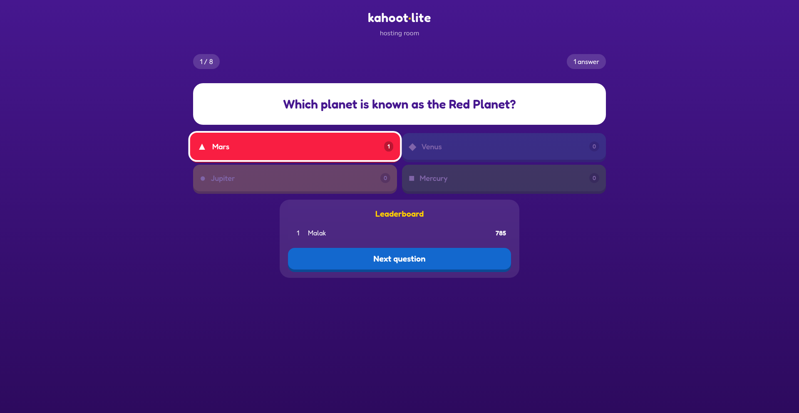

# kahoot·lite

A real-time multiplayer quiz game in the browser. One person hosts a room, friends join with a five-letter code, and everyone answers together on their own screen while a leaderboard updates live.



**Live demo:** https://malakmo7amed309.github.io/kahoot-lite/

## Standout feature

The whole game runs on real-time broadcast: the host's screen, every player's answer pad, the countdown, per-answer results and the final podium all stay in sync across tabs and devices with no accounts and no backend server. Answer fast and chain correct answers to build a streak for bonus points.

## What it does

- Host creates a room and gets a shareable code and link.
- Players join with the code and a nickname, no sign-up.
- Three built-in quiz packs: General Knowledge, All About Egypt and Web Dev Trivia.
- Streak scoring: faster correct answers earn more, consecutive correct answers add a growing streak bonus.
- Live answer counts, per-question leaderboard and an animated final podium.
- Host screen and player screens are the same app on different routes.

## Stack

- React + Vite
- Tailwind CSS v4
- Supabase Realtime (broadcast channels), no database writes

## Run locally

```bash
npm install
npm run dev
```

The host tab is the game authority: it runs the timers, scores answers and broadcasts state. If the host closes the tab the room ends. The production build is a single self-contained `docs/index.html`, deployed to GitHub Pages from the `docs/` folder.
